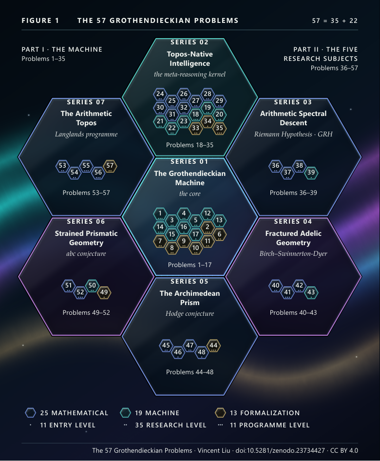

# The 57 Grothendieckian Problems

**An overview, twelve theses and fifty-seven open problems on mathematics and machine reasoning, drawn from the seven
works of the [Grothendieckian Programme](https://alienmuse.github.io/grothendieckian-programme/).**

> “All right, take 57.” — as told in A. Jackson, *Notices of the AMS* 51 (2004), p. 1196. Fifty-seven is 3 × 19.

This repository holds three papers and their data, released together:

1. **The Grothendieckian Programme: An Overview** — *Seven Open Works on Mathematics and Machine Reasoning*
   ([PDF](papers/The-Grothendieckian-Programme-An-Overview.pdf), doi:[10.5281/zenodo.23734421](https://doi.org/10.5281/zenodo.23734421)):
   the architecture, the five research subjects, the method, the series and its records, and the research plan, in
   ten pages.
2. **The Rising-Sea Theses** — *Twelve Theses on Mathematics and Machine Reasoning* ([PDF](papers/The-Rising-Sea-Theses.pdf),
   doi:[10.5281/zenodo.23734423](https://doi.org/10.5281/zenodo.23734423), [text](THESES.md)).
3. **The 57 Grothendieckian Problems** — *Open Problems for Mathematics and Machine Reasoning from the Grothendieckian
   Programme* ([PDF](papers/The-57-Grothendieckian-Problems.pdf), doi:[10.5281/zenodo.23734426](https://doi.org/10.5281/zenodo.23734426),
   [cards](problems/), [`problems.json`](problems.json), [Lean statements](formal/)).

The thirteen figures of the three papers, with their sources and data, are in [`figures/`](figures/). The PDFs are
signed: [`papers/SHA256SUMS`](papers/SHA256SUMS) with its OpenPGP signature and timestamps; see
[`papers/VERIFY.md`](papers/VERIFY.md).

The seven source works ([S01; S02; S03; S04; S05; S06; S07]; overview volume [S00]) comprise 34 volumes and 26,021
pages, released on Zenodo in October 2026 as first drafts that have not been peer-reviewed. None of them claims a proof
of the Riemann Hypothesis, the Birch and Swinnerton-Dyer conjecture, the Hodge conjecture, the *abc* conjecture or the
Langlands correspondence, and none of the problems below is one of those conjectures.

## The twelve theses

1. **Worlds, not isolated theorems.** For a reasoning system, the unit of mathematical knowledge is a typed, verifiable world, not an isolated theorem.
2. **Status is part of the type.** The epistemic status of a statement belongs to its type.
3. **A structured latent space.** Mathematical reasoning needs a structured, non-vectorial latent space.
4. **Attention as descent.** Attention can be rebuilt as descent.
5. **Report failure; abstain without evidence.** A reasoning system should report where local information fails to glue, and abstain when independent overlap data are absent.
6. **A chain of non-implications.** Operational completion does not imply mathematical validity, which does not imply epistemic promotion, which does not imply publication.
7. **Machines propose; humans authorize.** Machines may propose; humans authorize publication.
8. **The rising sea.** Hard problems are better approached by raising the surrounding theory than by direct attack.
9. **State what is not established.** A result is not complete until it states what it does not establish.
10. **Discovery is recursive.** Mathematical discovery is recursive: propose, test against what is known, abstract what survives, ask again.
11. **Creating language.** A mathematical reasoning system must be able to create notation and language, not only use them.
12. **Judge a method by its open ledger.** A method should be judged by an open ledger of what it establishes, what it reduces to stated hypotheses, and what it leaves open.

## The fifty-seven problems

Problems 1–35 come from the two works on the architecture of a reasoning system for mathematics (Series 01 and 02);
Problems 36–57 from the five works that each take a named conjecture or programme as research subject (Series 03–07).
Every problem states what counts as a solution. Every quotation has been checked against the published PDFs, and every
problem against the literature (28 October 2026; the records are in the paper and in `problems.json`).

| # | Problem | Source | Kind | Level | Thesis |
|---|---|---|---|---|---|
| [1](problems/01.md) | The first rising-sea event | S01 | machine | programme | 8 |
| [2](problems/02.md) | A bounded fixed point of the coupled world–language cycle | S01 | formalization | programme | 10 |
| [3](problems/03.md) | From obstruction to conjecture | S01 | machine | research | 10 |
| [4](problems/04.md) | Minimal extension questions | S01 | machine | research | 1 |
| [5](problems/05.md) | Target fidelity | S01 | machine | research | 6 |
| [6](problems/06.md) | Verified encodings of universal properties | S01 | formalization | research | 3 |
| [7](problems/07.md) | The AURORA-K0 kernel, I: syntax and checking | S01 | formalization | research | 2 |
| [8](problems/08.md) | The AURORA-K0 kernel, II: a model and relative consistency | S01 | formalization | research | 2 |
| [9](problems/09.md) | The seven obligations of descent execution | S01 | formalization | research | 5 |
| [10](problems/10.md) | Non-self-authorization | S01 | formalization | research | 7 |
| [11](problems/11.md) | Evolution without authority | S01 | formalization | research | 7 |
| [12](problems/12.md) | Deterministic identity across implementations | S01 | machine | entry | 6 |
| [13](problems/13.md) | A frozen benchmark for counterexample and proof discovery | S01 | machine | entry | 12 |
| [14](problems/14.md) | The language forge, end to end | S01 | machine | programme | 11 |
| [15](problems/15.md) | A preregistered test of typed base change | S01 | machine | entry | 1 |
| [16](problems/16.md) | A preregistered test of the four judgments of gluing | S01 | machine | entry | 5 |
| [17](problems/17.md) | A preregistered test of obstruction records | S01 | machine | entry | 5 |
| [18](problems/18.md) | Discovering the site | S02 | machine | programme | 3 |
| [19](problems/19.md) | The capability wager | S02 | machine | research | 4 |
| [20](problems/20.md) | Nerve baselines between GRPO and RLOO | S02 | machine | research | 4 |
| [21](problems/21.md) | Relative obstruction as a predictor of unsupported answers | S02 | machine | research | 5 |
| [22](problems/22.md) | Topos-MoE against modern sparse mixture-of-experts | S02 | machine | research | 4 |
| [23](problems/23.md) | A defence against a globally coherent falsehood | S02 | machine | programme | 5 |
| [24](problems/24.md) | Compiled-to-streaming descent stability | S02 | mathematical | research | 4 |
| [25](problems/25.md) | The Beck–Chevalley square 12.6.3 | S02 | mathematical | research | 4 |
| [26](problems/26.md) | Sharp accumulation bounds for equivariance defects | S02 | mathematical | research | 6 |
| [27](problems/27.md) | Local dynamics of the restriction-frame locus | S02 | mathematical | research | 4 |
| [28](problems/28.md) | A base-change bound for the descent solve | S02 | mathematical | research | 4 |
| [29](problems/29.md) | The training-to-serving deviation | S02 | mathematical | research | 6 |
| [30](problems/30.md) | Monotone refinement budgets | S02 | mathematical | research | 5 |
| [31](problems/31.md) | How many ambiguity axes are there? | S02 | mathematical | research | 2 |
| [32](problems/32.md) | Second-order disagreement without engineering | S02 | mathematical | research | 5 |
| [33](problems/33.md) | Formalizing uniform circuit classes | S02 | formalization | research | 9 |
| [34](problems/34.md) | A second kernel | S02 | formalization | entry | 6 |
| [35](problems/35.md) | The computational-univalence bridge | S02 | formalization | programme | 4 |
| [36](problems/36.md) | Polarization of a cyclotomic spectrum | S03 | mathematical | research | 8 |
| [37](problems/37.md) | Construction Problem A1 on the syntomic stack | S03 | mathematical | research | 8 |
| [38](problems/38.md) | Archimedean Frobenius from quaternionic THH | S03 | mathematical | research | 8 |
| [39](problems/39.md) | A certified inertia for the pole-removed Weil form | S03 | machine | entry | 9 |
| [40](problems/40.md) | The Tamagawa factor as a local term | S04 | mathematical | research | 9 |
| [41](problems/41.md) | The arithmetic flow | S04 | mathematical | programme | 8 |
| [42](problems/42.md) | Sub-conductor rank detection | S04 | mathematical | research | 12 |
| [43](problems/43.md) | Murmurations from the flow: a falsification test | S04 | machine | entry | 9 |
| [44](problems/44.md) | The Hodge decomposition in Lean | S05 | formalization | programme | 9 |
| [45](problems/45.md) | No δ-structure on the archimedean prism | S05 | mathematical | research | 9 |
| [46](problems/46.md) | Independence of the twelve prism axioms | S05 | mathematical | entry | 12 |
| [47](problems/47.md) | Descent beyond the polarized case | S05 | mathematical | research | 5 |
| [48](problems/48.md) | A prism reading of Voisin’s counterexample | S05 | mathematical | entry | 9 |
| [49](problems/49.md) | Close the formal algebra leaf | S06 | formalization | entry | 9 |
| [50](problems/50.md) | Toward an algorithm for prismatic cohomology | S06 | machine | research | 12 |
| [51](problems/51.md) | The real-place gauge | S06 | mathematical | research | 8 |
| [52](problems/52.md) | The gluing problem for the global substrate | S06 | mathematical | programme | 8 |
| [53](problems/53.md) | The multiplicative-group gate | S07 | mathematical | research | 9 |
| [54](problems/54.md) | The first falsification test for GL$_2$ | S07 | mathematical | research | 9 |
| [55](problems/55.md) | Ambidexterity over the arithmetic base | S07 | mathematical | programme | 8 |
| [56](problems/56.md) | Construct the global arithmetic curve | S07 | mathematical | programme | 8 |
| [57](problems/57.md) | Coherence for arithmetic modes | S07 | formalization | research | 11 |

## Taking part

Each problem has an issue: post a solution, a partial result, a counterexample to the problem as stated, a reference
showing that it is already solved, or a correction. A solution that meets the criterion of its card is recorded,
under the solver's name, in the next version of the papers, in the next edition of the source work, and in
[SOLVED.md](SOLVED.md). No prize is attached. Corrections to the papers go to [ERRATA.md](ERRATA.md). See
[CONTRIBUTING.md](CONTRIBUTING.md).

For AI laboratories and tool builders: `problems.json` lists every problem with its source, status, kind and decision
criterion, and `formal/` contains Lean 4 statements against a pinned Mathlib; both may be used as a benchmark under
the licences below.

## Licence and name

Text, data and figures: [CC BY 4.0](LICENSE). Code — the Lean files (`formal/`), the scripts (`tools/`), the
typesetting files (`styles/`, `filters/`) and the source code of the figures (`figures/web/`): [Apache-2.0](LICENSE-CODE).
The fonts and three.js in `figures/web/` keep their own licences. The seven works keep their own licence
(CC BY-NC-ND 4.0). The adjective *Grothendieckian* names a method used in the works and implies no attribution of
design or endorsement to Alexander Grothendieck; see [NOTICE](NOTICE). Author: Vincent Liu, WiseMotif.ai, ORCID
[0009-0000-8718-222X](https://orcid.org/0009-0000-8718-222X), <vincent.liu@wisemotif.ai>.

## References

[S00] Vincent Liu, *The Grothendieckian Programme: Recursive Mathematical Discovery in the Age of Machine Reasoning*, Zenodo, 2026, An overview of Series 01–07; WiseMotif Monograph of Mathematical Intelligence, Series 00, doi:[10.5281/zenodo.23669107](https://doi.org/10.5281/zenodo.23669107).

[S01] Vincent Liu, *GAI-MUA: The Grothendieckian Machine. A Mathematical Universe Architecture for Verifiable and Self-Evolving Artificial Intelligence*, Zenodo, 2026, WiseMotif Monograph of Mathematical Intelligence, Series 01; 6 volumes, doi:[10.5281/zenodo.23480696](https://doi.org/10.5281/zenodo.23480696).

[S02] Vincent Liu, *GM-Omega-Infinity: Topos-Native Intelligence. A Sheaf-Theoretic Architecture for Verifiable Machine Intelligence*, Zenodo, 2026, Series 02; 5 volumes, doi:[10.5281/zenodo.23538544](https://doi.org/10.5281/zenodo.23538544).

[S03] Vincent Liu, *Arithmetic Spectral Descent: Obstruction Theory, Hodge–Krein Realization, and a Falsifiable Architecture for the Riemann Hypothesis*, Zenodo, 2026, Series 03; 4 volumes, doi:[10.5281/zenodo.23564898](https://doi.org/10.5281/zenodo.23564898).

[S04] Vincent Liu, *Fractured Adelic Geometry: A Foundational Framework for the Birch and Swinnerton-Dyer Conjecture*, Zenodo, 2026, Series 04; 4 volumes, doi:[10.5281/zenodo.23585887](https://doi.org/10.5281/zenodo.23585887).

[S05] Vincent Liu, *The Archimedean Prism: Tame Period Geometry and the Hodge Conjecture*, Zenodo, 2026, Series 05; 5 volumes, doi:[10.5281/zenodo.23597954](https://doi.org/10.5281/zenodo.23597954).

[S06] Vincent Liu, *Strained Prismatic Geometry: Deformation over the Absolute Base and the abc Conjecture*, Zenodo, 2026, Series 06; 5 volumes, doi:[10.5281/zenodo.23610034](https://doi.org/10.5281/zenodo.23610034).

[S07] Vincent Liu, *The Arithmetic Topos: Foundations of a Trace-Theoretic Approach to the Langlands Programme*, Zenodo, 2026, Series 07; 5 volumes, doi:[10.5281/zenodo.23629681](https://doi.org/10.5281/zenodo.23629681).
